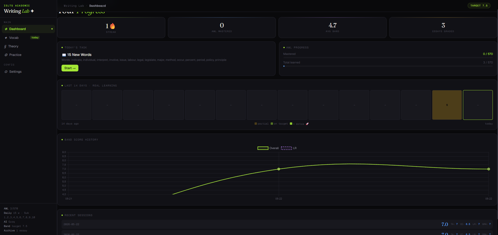
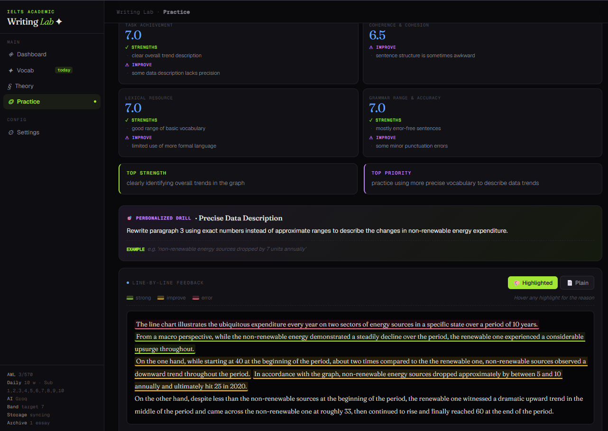
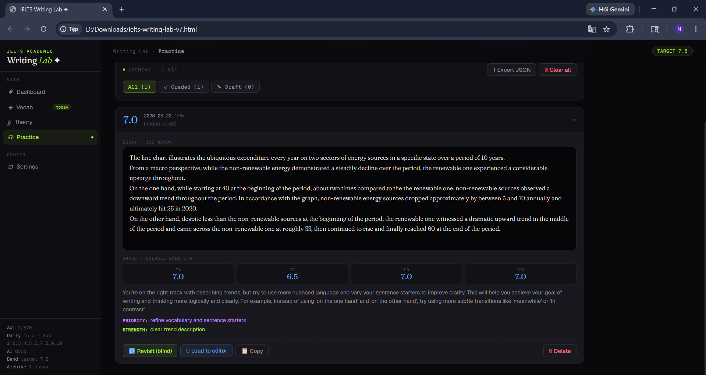
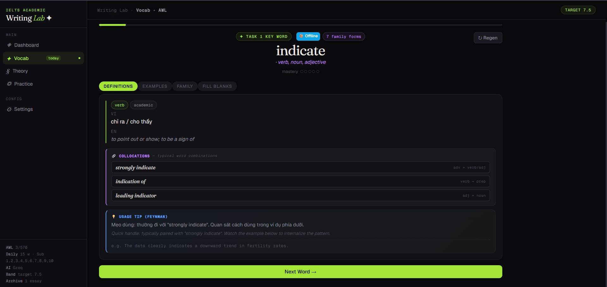

# IELTS Writing Lab

An AI-assisted, local-first workspace for IELTS Academic practice across Writing, Reading, Listening, Speaking, and Vocabulary.

The app runs in the browser, keeps study progress under your control, and supports either cloud AI providers or a project-local Ollama model. It is designed for personal study and is not affiliated with IELTS, Cambridge University Press & Assessment, or the British Council.



## What It Includes

| Area | Main capabilities |
|---|---|
| Writing | Task 1 and Task 2 prompts, timed full tests, four-criterion AI grading, model answers, sentence-level reasoning, rewrite trainer, error bank, and score history |
| Reading | Mini drills, single sections, full tests, 16 question types, strategy coaching, highlighting, notes, answer review, and weakness analytics |
| Reading imports | Import complete documents while preserving all detected passages, instructions, question numbers, options, and question order |
| Listening | Section practice, transcript review, source import, answer checking, and optional locally generated audio |
| Speaking | Offline self-practice, minimal-pair drills, and optional scored attempts through the local FastAPI backend |
| Vocabulary | Academic Word List flashcards, spaced repetition, quizzes, word debt, custom vocabulary, and AI lexis enrichment |
| Dashboard | Activity heatmap, study telemetry, score trends, and weakness tracking |

Generated Reading passages are saved into a reusable dataset. Selected entries can act as few-shot style references for later generations.



## Choose a Running Mode

| Mode | Start command | Best for | Important limits |
|---|---|---|---|
| Direct-open | Double-click `index.html` | Fastest start; normal browser-based practice | Browser storage only; some imports and provider calls may be restricted by browser CORS |
| Local app server | `node scripts/serve.mjs` | Recommended daily use | Requires Node.js; opens at `http://localhost:5173` |
| Project-local AI | `start-local-ai.bat` | AI use without a cloud API key | Windows setup; requires several GB of disk and enough RAM/VRAM |
| Speaking backend | `start-speaking-backend.bat` | Scored Speaking attempts and optional Listening TTS | Requires Python environment; audio transcription also requires `ffmpeg` |

The modes can be combined. A typical local setup runs the app server, project-local AI, and Speaking backend at the same time.

## Quick Start

### Basic browser mode

1. Clone or download the repository.
2. Double-click `index.html`.
3. Open **Settings** and add an AI provider, or use non-AI practice features.
4. Export a backup periodically from **Settings > Data Management**.

### Recommended local server mode

Install a recent Node.js release, then run:

```powershell
node scripts/serve.mjs
```

Open `http://localhost:5173`.

This mode enables:

- folder-backed study-state storage;
- the local AI proxy for providers that cannot be called directly by the browser;
- stronger URL and document import routes;
- the **Storage: browser <-> folder** control.

No `npm install` is required. The project ships the browser libraries it needs and can fall back to CDN copies.

## Project-Local AI on Windows

The repository does not commit multi-GB model files. Instead, a tracked setup script creates a portable Ollama runtime and model store under the ignored `.local/` directory.

Run once:

```powershell
.\setup-local-ai.bat
```

The setup:

1. copies an existing Ollama runtime when available, or downloads the official standalone runtime;
2. stores the runtime and models inside this project;
3. downloads the default `qwen2.5:7b` base model;
4. creates the app model alias `ielts-fighter`.

After setup:

```powershell
.\start-local-ai.bat
.\stop-local-ai.bat
```

The local API runs at `http://localhost:11434`.

In **Settings**:

- local Writing grading uses `ielts-fighter` when enabled;
- selecting the **Local Ollama** provider routes other AI tasks through the same local model;
- cloud providers can remain configured as fallbacks.

Uninstalling system-wide Ollama does not affect the project-local copy. If system Ollama is already using port `11434`, quit it before running `start-local-ai.bat`.

### Custom base model

PowerShell users can choose another Ollama base model during first setup:

```powershell
.\scripts\setup-local-ai.ps1 -BaseModel "your-model:tag"
```

Model quality and hardware requirements vary. The default local model is practical for offline use, but stronger cloud models may produce more reliable complex Reading questions and structured grading.

## Speaking Setup

The Speaking backend provides:

- local speech-to-text through `faster-whisper`;
- acoustic feature extraction;
- examiner feedback from any OpenAI-compatible model;
- local SQLite attempt storage.

### Local examiner, no cloud API key

From the project root:

```powershell
.\setup-local-ai.bat
.\setup-speaking-backend-local.bat
.\start-speaking-backend.bat
```

The first scored attempt downloads the selected Whisper model if it is not already cached.

### Cloud examiner

```powershell
cd speaking-backend
python -m venv .venv
.\.venv\Scripts\python.exe -m pip install -r requirements.txt
copy .env.example .env
```

Edit `speaking-backend/.env`, configure an OpenAI-compatible examiner, then return to the project root and run:

```powershell
.\start-speaking-backend.bat
```

Install `ffmpeg` so the backend can decode browser audio:

```powershell
winget install Gyan.FFmpeg
```

See [speaking-backend/README.md](speaking-backend/README.md) for backend details.

## Document Import

The local app server can use an in-project MarkItDown environment to convert PDFs, Word files, slides, spreadsheets, HTML, CSV, and other supported documents:

```powershell
node scripts/setup-markitdown.mjs
node scripts/serve.mjs
```

The generated `markitdown-venv/` directory is ignored by Git. Recreate it after moving the project instead of copying the virtual environment.

For Reading uploads, the AI is instructed to preserve the complete detected test rather than replace it with newly generated questions. Very large files still depend on the selected provider's context and output limits.

## AI Providers

The Settings page supports:

- project-local Ollama;
- Gemini;
- OpenAI-compatible APIs such as Groq, OpenRouter, DeepSeek, Kimi, Together, NVIDIA, Mistral, OpenAI, and others;
- Anthropic-compatible requests;
- custom provider URLs and models;
- optional provider failover when the active provider is unavailable.

Provider availability, pricing, model names, quotas, and regional access change over time. Verify current provider terms before relying on a specific service.

API keys are stored in browser `localStorage`, not in `data/app-state.json`. Cloud-provider requests leave your machine and are subject to that provider's privacy policy. Use Local Ollama when you need the AI request itself to remain local.

## Data and Privacy

The project has no account system, analytics service, or hosted application backend.

| Location | Contents | Git behavior |
|---|---|---|
| Browser key `ielts_writing_lab_v1` | Study progress, essays, tests, datasets, and drafts | Not part of the project folder |
| Browser key `ielts_lab_configs` | AI provider configurations, including API keys | Not part of the project folder |
| `data/app-state.json` | Optional folder-backed study-state mirror | Ignored by Git |
| `speaking-backend/data/` | Local Speaking SQLite data | Ignored by Git |
| `.local/` | Project-local Ollama runtime, models, PID, and logs | Ignored by Git |
| `markitdown-venv/` | Document-conversion Python environment | Ignored by Git |

Important boundaries:

- Cloud AI, Wikipedia grounding, URL import, and other explicitly requested network features send requests outside the machine.
- Imported exam material, essays, transcripts, and generated datasets may contain private or copyrighted content.
- Do not commit personal data, `.env` files, model blobs, or API keys.

## Reading Workflow

Generated Reading practice uses a multi-step pipeline:

1. optional factual grounding;
2. passage generation with IELTS-oriented style constraints;
3. an AI-tell filter and corrective retry;
4. specialist question generation by question type;
5. dataset save for later practice and optional few-shot use.

The practice interface supports strict answer checking, word-limit validation, source question numbers, flags, notes, highlighting, review analytics, and strategy prompts that do not reveal the answer before submission.



## Vocabulary and Progress Tracking

Vocabulary practice includes the 570-word Academic Word List, spaced repetition, daily targets, custom words, quizzes, and AI enrichment. Writing and Reading attempts feed score history and weakness analytics on the dashboard.



## Development

### Main commands

```powershell
# Rebuild generated application files after editing src/
node scripts/build.mjs

# Run the local app server
node scripts/serve.mjs

# Create the optional document-import environment
node scripts/setup-markitdown.mjs

# Validate the portable local-AI setup without downloading or starting anything
.\scripts\setup-local-ai.ps1 -DryRun
```

`scripts/build.mjs` rebuilds:

- `dist/app.jsx`;
- the direct-open `index.html`.

Edit source files under `src/`; do not manually edit generated application output unless you are intentionally changing the build process.

### Project structure

```text
.
|-- src/                    Browser application source
|-- dist/                   Generated application bundle
|-- scripts/                Build, server, import, and local-AI scripts
|-- speaking-backend/       Optional FastAPI Speaking service
|-- local-ai/               Tracked Ollama Modelfile template
|-- vendor/                 Browser runtime dependencies
|-- screenshots/            README screenshots
|-- data/                   Optional local study-state file
|-- index.html              Direct-open generated application
`-- styles.css              Application styles
```

## Source-Control Safety

Before publishing changes, confirm that ignored local data has not been added manually:

- `data/app-state.json`
- `speaking-backend/.env`
- `speaking-backend/data/`
- `.local/`
- `markitdown-venv/`
- browser-exported study backups

Runtime and model files must not be committed. GitHub users should run `setup-local-ai.bat` after cloning.

## Troubleshooting

### Local AI will not start

- Quit system Ollama if it owns port `11434`.
- Run `setup-local-ai.bat` once.
- Check `.local/ollama/logs/ollama.err.log`.
- In Settings, use **Test connection** under Local IELTS examiner model.

### Local AI works for grading but not generation

Writing local grading and the active general AI provider are separate settings. Select **Local Ollama** as the active provider to use it for generation and other AI tasks.

### Folder storage or document import is unavailable

Run `node scripts/serve.mjs` and open `http://localhost:5173` instead of double-clicking `index.html`.

### Speaking scoring is unavailable

- Run `start-speaking-backend.bat`.
- Confirm `http://localhost:8000/api/health` responds.
- Install `ffmpeg`.
- Check the Speaking backend `.env` and terminal output.

## Limitations

- AI feedback is useful for practice and trend tracking, but it is not an official IELTS score.
- Generated and AI-extracted questions require human judgment, especially for ambiguous answer keys.
- Local model quality depends on the selected model and available hardware.
- The app is desktop-first and single-user; it does not provide account-based sync.
- Cloud features may incur costs and are subject to provider limits.
- You are responsible for the rights to imported or redistributed study material.

## License

The source code and project documentation are licensed under the [MIT License](LICENSE).

The license does not grant redistribution rights for third-party audio, transcripts, imported passages, copied exam material, personal datasets, user exports, API keys, or files saved under local data directories.
